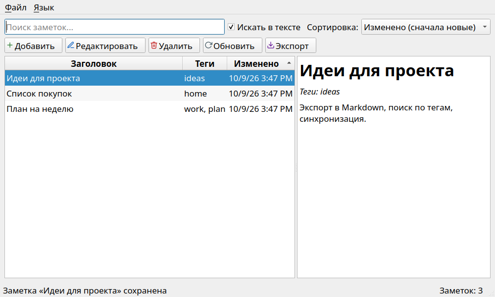
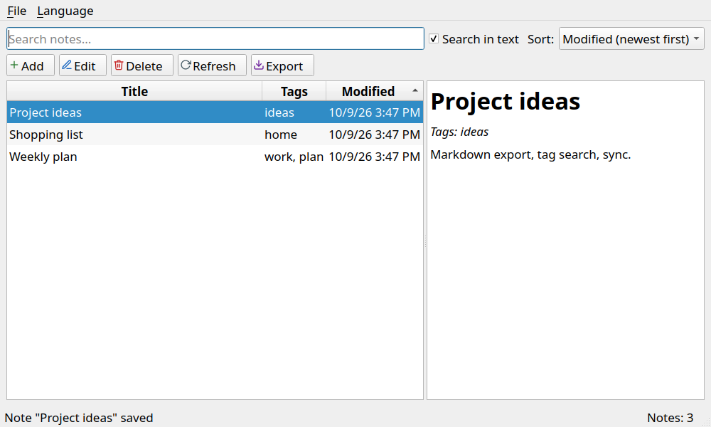
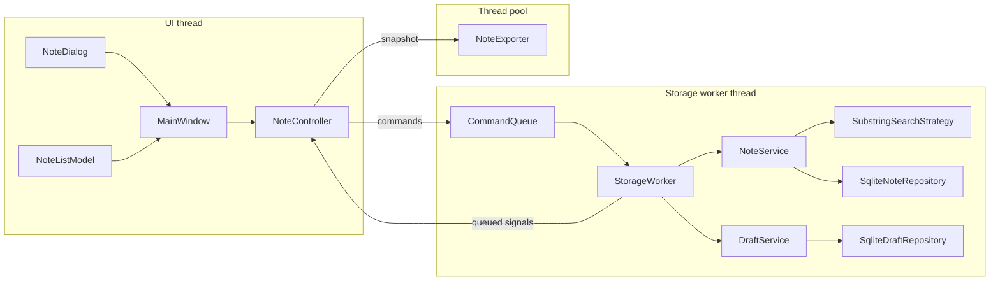

# NoteManager

Десктопный менеджер заметок на **C++17 / Qt 5.15 / SQLite**. Заметки хранятся в локальной базе SQLite,
интерфейс не блокируется операциями с БД, несохранённые правки автоматически сохраняются в виде
черновиков и восстанавливаются после аварийного завершения.



<details>
<summary>English UI</summary>



</details>

## Возможности

- Список заметок (`QTableView`), предпросмотр выбранной заметки (Markdown), кнопки **Добавить / Редактировать / Удалить / Обновить**.
- Поиск по подстроке в заголовке и (опционально) в тексте; регистронезависимый, в том числе для кириллицы.
- Диалог редактирования: заголовок (обязателен, до 100 символов), многострочный текст, теги, даты создания/изменения (только чтение).
- CRUD в SQLite, файл БД и таблицы создаются при первом запуске.
- Сортировка по дате и заголовку (выпадающий список или клик по заголовку колонки), выбор запоминается.
- Экспорт выбранной заметки в `.txt` / `.md` (запись файла в пуле потоков, атомарная замена файла).
- Горячие клавиши: `Ctrl+N` создать, `Ctrl+S` сохранить (в диалоге), `Delete` удалить (в списке), `F2` редактировать, `F5` обновить, `Ctrl+E` экспорт.
- Автосохранение черновика каждые 30 секунд и восстановление после аварийного закрытия.
- Интерфейс на русском и английском (меню **Язык**, переключение без перезапуска).

## Сборка и запуск (Linux)

Проверено на Ubuntu 26.04.

### Зависимости

```bash
sudo apt install build-essential cmake ninja-build qtbase5-dev libqt5sql5-sqlite \
                 libqt5svg5-dev qttools5-dev qttools5-dev-tools libgl-dev
# опционально для проверки БД и памяти:
sudo apt install sqlite3 valgrind
```

`qttools5-dev` нужен для модуля CMake `Qt5LinguistTools` (переводы), `libqt5svg5-dev` - для SVG-иконок.

### Сборка

```bash
cd NoteManager
cmake -S . -B build -G Ninja -DCMAKE_BUILD_TYPE=Release
cmake --build build
```

Если Qt 5.15 установлен не в системные пути (например, через `aqtinstall`), добавьте
`-DCMAKE_PREFIX_PATH=/путь/к/Qt/5.15.2/gcc_64`.

### Запуск

```bash
./build/NoteManager                      # БД: ~/.local/share/NoteManager/NoteManager/notes.db
./build/NoteManager --db /tmp/notes.db   # явный путь к файлу БД
```

### Тесты

```bash
cd build && ctest --output-on-failure    # 8 наборов, GUI-тесты идут через платформу offscreen
```

### Проверка памяти

```bash
cmake -S . -B build-asan -G Ninja -DCMAKE_BUILD_TYPE=Debug -DENABLE_ASAN=ON
cmake --build build-asan
cd build-asan && ctest --output-on-failure         # AddressSanitizer + UBSan + LeakSanitizer
valgrind --leak-check=full ./NoteManager --db /tmp/vg.db   # на обычной (не ASan) сборке
```

Тесты LeakSanitizer используют `tests/lsan.supp`: в нём только разовые аллокации сторонних библиотек
(fontconfig, плагин `offscreen`), код проекта утечек не даёт.

### Проверка БД и зависимостей из терминала

```bash
sqlite3 ~/.local/share/NoteManager/NoteManager/notes.db '.schema'
sqlite3 -header -column ~/.local/share/NoteManager/NoteManager/notes.db \
    'SELECT id, title, tags, created_at, updated_at FROM notes;'
sqlite3 ~/.local/share/NoteManager/NoteManager/notes.db 'SELECT draft_key, title, saved_at FROM drafts;'
ldd build/NoteManager | grep -E 'Qt5|not found'
ps -o pid,nlwp,cmd -C NoteManager        # nlwp - число потоков (UI + воркер БД + пул)
find ~/.local/share/NoteManager -name 'notes.db*'
```

В режиме WAL рядом с `notes.db` лежат файлы `notes.db-wal` и `notes.db-shm`: это нормально.

## Использованные версии

| Компонент | Версия |
|---|---|
| Qt | 5.15.2 (на Ubuntu 26.04 в репозитории - 5.15.18, API тот же) |
| Компилятор | GCC 15.2.0, `-std=c++17` |
| CMake | 4.4.4 (минимум в проекте - 3.16) |
| Генератор | Ninja 1.13 |
| SQLite | 3.46.1 |
| ОС | Ubuntu 26.04 |

Не проверялось: valgrind и `sqlite3` CLI в окружении разработки установить не удалось (нет прав на
`apt`), поэтому проверка памяти выполнена AddressSanitizer/LeakSanitizer, а БД проверялась через
`python3 -m sqlite3` (тот же движок). Команды выше рассчитаны на обычную систему с этими пакетами.

## Архитектура



Принцип: **UI - тонкий асинхронный клиент**. Виджеты рисуют состояние и отправляют намерения
пользователя в `NoteController`; SQL, валидации и алгоритмов поиска в них нет. Интерфейсы описывают
контракты, реализации подменяются (SQLite / тестовые, подстрока / FTS).

| Слой | Класс | Ответственность |
|---|---|---|
| Домен (`src/domain`) | `Note`, `Draft` | Сущности. Даты всегда в UTC. |
| | `INoteRepository` | Контракт доступа к заметкам (`getAll/getById/add/update/remove`; плюс `lastInsertId`, `lastError`). |
| | `IDraftRepository`, `ITransactionManager` | Хранилище черновиков и единица работы (атомарные группы операций). |
| | `INoteSearchStrategy`, `SubstringSearchStrategy` | Алгоритм поиска; точка расширения (теги, FTS, нечёткий поиск). |
| | `NoteValidator` | Чистые правила: заголовок не пуст, <= 100 символов. Возвращает коды, а не тексты. |
| | `NoteService`, `DraftService` | Прикладная логика: валидация, метки времени, поиск, классификация черновиков. |
| | `ISettings` | Контракт пользовательских настроек. |
| Хранилище (`src/storage`) | `SqliteConnection` | Соединение `QSqlDatabase`, pragma (WAL), создание схемы. |
| | `SqliteNoteRepository : INoteRepository` | Реализация на SQLite, только `prepare` + `bindValue`. |
| | `SqliteDraftRepository`, `SqliteTransactionManager` | Таблица `drafts`, транзакции. |
| | `CommandQueue`, `commands.h` | Упорядоченная очередь команд (`std::variant`), слияние черновиков. |
| | `StorageWorker` | Выполняет команды в отдельном потоке, владеет соединением и сервисами. |
| Приложение (`src/app`) | `NoteController` | Асинхронный фасад для UI: запросы с `requestId`, результаты сигналами. |
| | `NoteExporter` | Рендер и запись `.txt`/`.md` (`QSaveFile`, `QTextStream`). |
| | `QSettingsAdapter`, `LanguageManager` | Реализация `ISettings`, переключение переводов. |
| UI (`src/ui`) | `MainWindow` | Главное окно, горячие клавиши, восстановление черновиков. |
| | `NoteDialog : QDialog` | Редактор заметки, валидация, автосохранение по таймеру. |
| | `NoteListModel : QAbstractTableModel` | Модель списка (снимок от контроллера) + `QSortFilterProxyModel` для сортировки. |

### Асинхронность и согласованность записи

- Все операции с БД идут через **одну FIFO-очередь команд** и выполняются **одним рабочим потоком**
  (`QThread` + `StorageWorker`). Соединение Qt SQL создаётся и закрывается в этом потоке (соединения
  нельзя разделять между потоками). Поэтому автосохранение и ручное сохранение не могут конфликтовать,
  а чтение всегда видит результат предыдущих записей пользователя.
- Последовательные черновики одной сессии **сливаются** в очереди (побеждает последний), поток быстрых
  правок не раздувает очередь.
- `SaveNote` - одна транзакция: «записать заметку + удалить черновик сессии». После закрытия сессии
  более поздние `SaveDraft` с её токеном отбрасываются, поэтому черновик не «воскреснет».
- Результаты списка/поиска с устаревшим `requestId` отбрасываются; ввод в поле поиска проходит debounce 250 мс.
- Выход: очередь дорабатывается до конца (все ожидающие записи применяются), затем поток останавливается.
- Экспорт: воркер читает актуальный снимок заметки через ту же очередь, а запись файла выполняет
  `QtConcurrent::run` в пуле потоков; интерфейс не блокируется.

### Автосохранение и черновики

- Черновики лежат в таблице `drafts` **того же файла SQLite** (`draft_key` = UUID сессии редактирования,
  `note_id`, поля формы, `base_updated_at`, `saved_at`). Отдельной таблицей, чтобы запись черновика не
  трогала `notes` и не меняла схему из задания; тем же файлом, чтобы «заметка + удаление черновика»
  были одной транзакцией.
- `NoteDialog` каждые 30 с, если были правки, отдаёт состояние формы; новая пустая заметка не сохраняется.
  Сохранение/отмена удаляют черновик. WAL + транзакции гарантируют, что после аварии в БД лежит последнее
  целое состояние.
- Конфликты: один черновик на сессию (`INSERT OR REPLACE`). При старте черновики классифицируются:
  новая заметка, без конфликта, заметка изменена позже (предупреждение о перезаписи), заметка удалена
  (восстановить как новую). По каждому пользователь выбирает **Восстановить / Отбросить / Решить позже**.
- Если сохранение заметки завершилось ошибкой, текст остаётся в черновике и предлагается к восстановлению.

### Решения, которые стоит знать

- **Поиск в памяти, а не в SQL.** `LIKE` и `lower()` в SQLite регистронезависимы только для ASCII, поэтому
  «заметка» не нашла бы «Заметка». Стратегия работает поверх `getAll()` через `QString::toCaseFolded()`;
  рассчитано на тысячи заметок, для большего есть точка расширения (`INoteSearchStrategy`, FTS5).
- **Даты** хранятся как ISO 8601 UTC (`2026-10-09T12:00:00.000Z`) в колонках `DATETIME` из задания:
  строки корректно сортируются и читаются в `sqlite3`; в UI показываются в локальном времени.
- **Интерфейс `INoteRepository`** сохранён из задания; добавлены `lastInsertId()` (интерфейс `bool add()`
  не возвращает id, а UI нужно выделить созданную заметку) и `lastError()`.
- **Умные указатели.** Объекты без Qt-родителя (контроллер, воркер, сервисы, репозитории, стратегии)
  принадлежат `std::unique_ptr`/`std::shared_ptr`. Виджеты создаются через `new` с родителем - это
  идиома Qt, владение у родителя, явных `delete` в коде нет.
- **Мультиязычность.** Исходные строки на английском, русский перевод в `translations/notemanager_ru.ts`
  (встраивается в бинарник через `.qrc`). Язык заметок не влияет на схему БД.

## Структура проекта

```
NoteManager/
  CMakeLists.txt
  src/
    main.cpp
    domain/    note.h, draft.h, inoterepository.h, idraftrepository.h, inotesearchstrategy.h,
               itransactionmanager.h, isettings.h, notevalidator.*, noteservice.*, draftservice.*,
               substringsearchstrategy.*, searchstrategyfactory.*
    storage/   sqliteconnection.*, sqlitenoterepository.*, sqlitedraftrepository.*,
               sqlitetransactionmanager.*, commands.h, commandqueue.*, storageworker.*
    app/       notecontroller.*, noteexporter.*, qsettingsadapter.*, languagemanager.*
    ui/        mainwindow.*, notedialog.*, notelistmodel.*
  resources/   resources.qrc, icons/*.svg, i18n.qrc.in
  translations/notemanager_ru.ts
  tests/       QtTest: validator, search, repository, services, command queue, controller, exporter, ui
  tools/       screenshot.cpp (опционально, -DBUILD_TOOLS=ON)
  docs/        исходные задания и скриншоты
```

Обновить переводы после изменения строк: `cmake --build build --target update_translations`.
Пересоздать скриншоты: `cmake -DBUILD_TOOLS=ON ...`, затем
`QT_QPA_PLATFORM=offscreen ./build/NoteManagerScreenshot docs/screenshots/main-window-ru.png ru`.

## Тесты

| Набор | Что проверяет |
|---|---|
| `tst_validator` | Пустой заголовок, граница 100 символов, пробелы по краям |
| `tst_search` | Пустой запрос, область поиска, регистронезависимость кириллицы |
| `tst_repository` | Создание схемы, CRUD, SQL-инъекции как данные, Unicode, откат транзакции, черновики |
| `tst_services` | Метки времени, валидация, поиск, классификация черновиков, закрытые сессии |
| `tst_commandqueue` | Порядок FIFO, слияние черновиков, черновик после сохранения не «перепрыгивает» его |
| `tst_controller` | Сквозной конвейер: порядок записей, устаревшие ответы, атомарное удаление черновика, переживание перезапуска, экспорт |
| `tst_exporter` | Формат `.txt`/`.md`, UTF-8, ошибки записи |
| `tst_ui` | Валидация и автосохранение диалога, список, поиск, предпросмотр, предложение и восстановление черновика после «аварии» |
